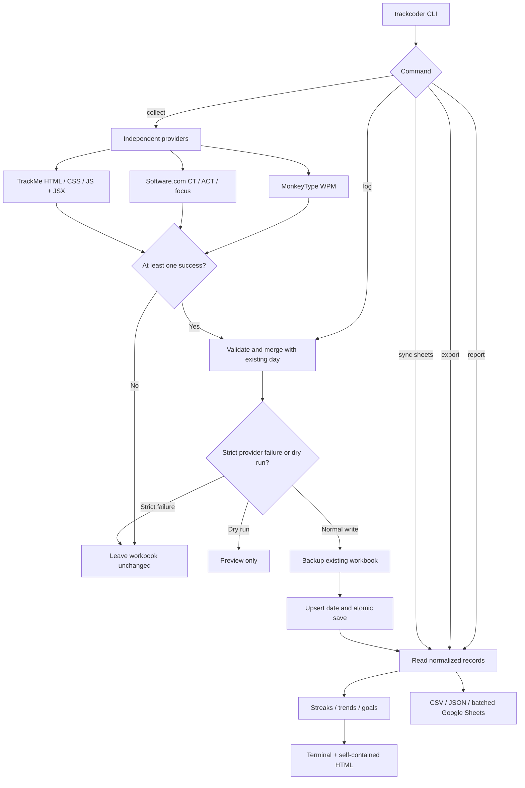

# Track Coder workflow

## Reliability invariants

1. Importing a module never opens a browser or performs network I/O.
2. A failed provider never replaces a previously stored measurement with a fake value.
3. No collection success means no workbook write.
4. Existing dates are updated, not duplicated; legacy duplicate rows are consolidated on update.
5. Damaged input workbooks are preserved.
6. Reports and exports are local-only unless the user explicitly invokes Google Sheets sync.
